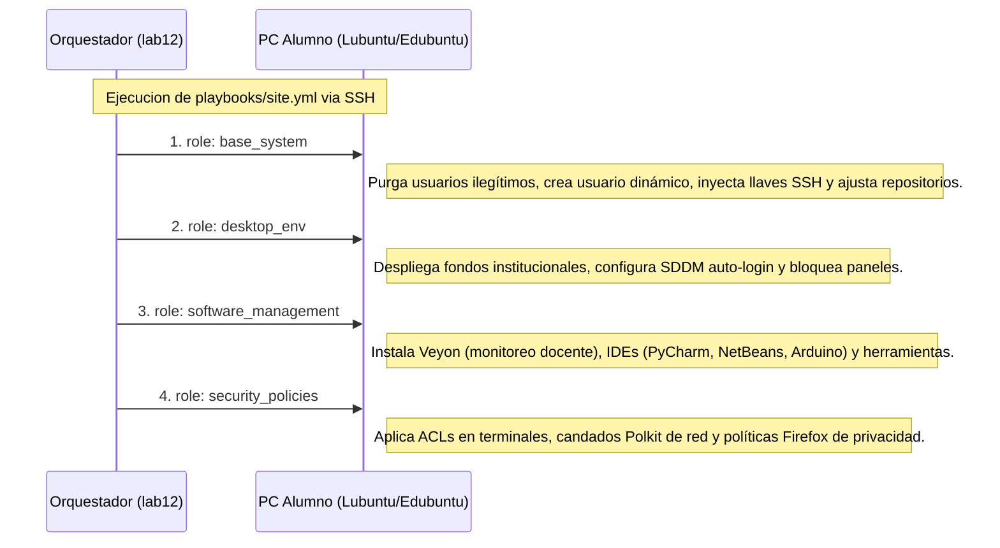

# Arquitectura del Sistema: Laboratorio Vasconcelos

El Laboratorio de Cómputo Vasconcelos opera bajo un modelo **Edge Computing y Orquestación Desatendida** gestionado declarativamente mediante Ansible, Bash scripting de bajo nivel y protocolos Wake-on-LAN.

El diseño arquitectónico responde a tres objetivos principales:
1. **Inmutabilidad y Seguridad de las Terminales de Alumnos:** Mantener los equipos protegidos contra alteraciones deliberadas o accidentales de configuración y software.
2. **Alta Disponibilidad sin Servidor Dedicado:** Reutilizar una estación de trabajo convencional del aula como nodo de control y orquestador permanente.
3. **Mantenimiento Cero-Intervención:** Garantizar que parches de seguridad, actualizaciones de paquetes y gestión energética ocurran de forma 100% desatendida.

---

## 1. Diagrama de Topología y Red

```mermaid
graph TD
    subgraph Aula de Computo
        subgraph Nodo Orquestador Edge [lab12 - Lenovo ThinkCentre M720s]
            S1[Cuenta Alumno alumno12: Sesion Grafica GNOME Restringida]
            S2[Cuenta Admin vasconceloslab12: Ansible Control Node / Cron / WoL]
            Hard[Hardening 9 Capas: BIOS Auto-Boot / Polkit / logind / DCONF / X11]
            Hard --- S1
            Hard --- S2
        end

        subgraph Flota Lubuntu LXQt [Nodos 00 al 11, 13 al 15]
            C1[lab00 - Docente]
            C2[lab01 a lab11 - Terminales Alumnos]
            C3[lab13 a lab15 - Terminales Alumnos]
        end
    end

    subgraph Infraestructura de Red Local [192.168.68.0/24]
        Deco((Router Mesh TP-Link Deco))
        Switch[Switch Ethernet Gigabit]
    end

    S2 -- "Provisionamiento y Parches (SSH Port 22)" --> Switch
    S2 -- "Wake-on-LAN Dual (UDP Port 9: Unicast + Broadcast)" --> Deco
    Deco --> Switch
    Switch --> C1
    Switch --> C2
    Switch --> C3
    Switch --> Nodo Orquestador Edge
```

---

## 2. Componentes Principales

### 1. El Orquestador Edge (`lab12` - Edubuntu / GNOME)
- **Hardware:** Lenovo ThinkCentre M720s conectado a la red cableada con IP estática `192.168.68.112`.
- **Doble Función Simultánea:**
  - **Día (Horario Escolar):** Terminal interactiva donde los alumnos acceden al usuario sin privilegios `alumno12`.
  - **24/7 (Fondo):** Servidor de control de Ansible, emisor de pings de watchdog y planificador maestro de tareas en `vasconceloslab12`.
- **Blindaje Multi-Capa:** BIOS configurado para encendido automático tras corte eléctrico (`State After G3 = Power On`), bloqueo físico del botón frontal, directiva `systemd-logind` ignorando teclas de energía, reglas Polkit impidiendo el apagado y candados DCONF impidiendo cualquier modificación de red o interfaz. (Ver detalle completo en [Hardening del Orquestador Edge](orquestador_edge_hardening.md)).

### 2. Flota de Clientes Ligeros (`lab00`-`lab11`, `lab13`-`lab15` - Lubuntu / LXQt)
- Optimizadas para máximo rendimiento y bajo consumo de memoria RAM.
- **Identidad Calculada:** Cada equipo ejecuta un perfil dinámico derivado matemáticamente de su último octeto IP (ej. IP `.103` genera el perfil `alumno03`).
- **Restricción de Privilegios:** Uso de Access Control Lists (ACL) de Linux en modo `---` para denegar la ejecución de emuladores de terminal (`qterminal`, `xterm`) y gestores de software (`plasma-discover`) a los alumnos.
- **Entorno de Red Seguro:** Reglas Polkit (`90-bloquear-red-alumnos.rules`) que impiden desconectar el cable de red o apagar el WiFi desde la interfaz gráfica.

---

## 3. Matriz de Hardening en Profundidad

| Capa | Componente | Mecanismo de Seguridad | Impacto Operativo |
| :--- | :--- | :--- | :--- |
| **1. BIOS / Hardware** | Lenovo UEFI | *State After G3 = Power On* + Desconexión de botón físico | El orquestador arranca solo tras cortes de luz; no puede ser apagado con el botón frontal. |
| **2. Kernel / Init** | `systemd-logind` | `99-ignorar-botones.conf` (`HandlePowerKey=ignore`) | Descarta señales de hardware o eventos ACPI de apagado y suspensión. |
| **3. Servidor Gráfico** | X11 / Xorg | `99-disable-vtswitch.conf` (`DontVTSwitch`, `DontZap`) | Bloquea consolas TTY (`Ctrl+Alt+F1-F12`) y el cierre forzado de Xorg. |
| **4. Entorno de Escritorio** | DCONF / GNOME | `button-power='nothing'`, candados de red y pantalla | Oculta y desactiva opciones de apagado y alteración de red en la GUI. |
| **5. Autorización** | PolicyKit (Polkit) | `99-bloquear-apagado.rules` y `90-bloquear-red.rules` | Requiere credenciales de root para cualquier intento de apagado o desconexión de red. |
| **6. Sistema de Archivos** | POSIX ACLs | `setfacl -m o::---` en binarios de sistema | Impide a los alumnos abrir terminales o instalar software no autorizado. |
| **7. Aplicaciones** | Firefox Policies | `/etc/firefox/policies/policies.json` | Desactiva telemetría, autoguardado de contraseñas y sanitiza cookies al cerrar. |
| **8. Automatización** | Cron & Watchdog | `vigilante.sh` (cada 2 min) y `orquestador.sh` (8:00 PM) | Auto-enciende máquinas apagadas durante el día y actualiza el aula de noche. |

---

## 4. Secuencia de Aprovisionamiento Maestro (`site.yml`)

Cuando se aprovisiona o restaura una máquina desde el orquestador, Ansible ejecuta los roles en el siguiente orden estricto:



---

## 5. Documentación Relacionada
- [Hardening y Arquitectura del Orquestador Edge](orquestador_edge_hardening.md)
- [Automatización, Auto-Curación y Ciclo Nocturno](automatizacion_nocturna.md)
- [Guía de Aprovisionamiento y Despliegue](guia_despliegue.md)
