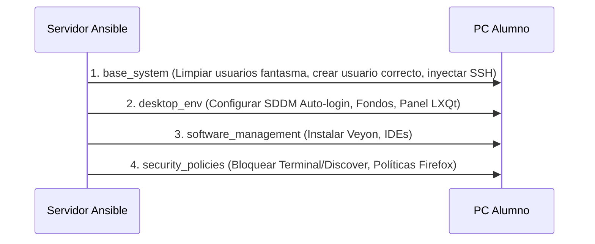

# Arquitectura del Laboratorio Vasconcelos

El Laboratorio de Cómputo Vasconcelos funciona bajo un modelo Cliente-Servidor gestionado de forma declarativa utilizando Ansible. El objetivo de esta arquitectura es mantener la inmutabilidad de los equipos de los alumnos, garantizar un entorno de trabajo limpio en cada sesión y automatizar tareas de mantenimiento.

## Diagrama de Arquitectura

```mermaid
graph TD
    subgraph Servidor [Servidor Maestro (Ubuntu 24.04)]
        A[Ansible Controller]
        B[Scripts de Operación bash]
        C[Ansible Vault Secrets]
    end

    subgraph Red [Red Mesh Local 192.168.68.x]
        D((Router / Deco))
    end

    subgraph Clientes [Equipos de Alumnos]
        E[Lubuntu PC 00-11, 13-15]
        F[Edubuntu PC 12]
    end

    A -- "Aprovisionamiento (SSH/Port 22)" --> D
    B -- "Wake-on-LAN (UDP/Port 9)" --> D
    C -. "Descifrado en RAM" .-> A
    D --> E
    D --> F
```

## Componentes Principales

1. **Servidor Maestro**: Actúa como el nodo de control (Control Node) de Ansible. No requiere agentes instalados en los clientes, operando enteramente a través de SSH. Almacena de manera segura (vía Ansible Vault) los hashes de contraseñas y llaves SSH.
2. **Equipos Lubuntu (LXQt)**: La mayoría de las máquinas. Optimizadas para bajo consumo de recursos, cuentan con entornos gráficos preconfigurados, restricciones vía ACL en aplicaciones del sistema, y software educativo desplegado automáticamente.
3. **Equipo Edubuntu (GNOME)**: Equipo con requerimientos de accesibilidad especiales, configurado de manera separada en el inventario.

## Flujo de Aprovisionamiento (Ansible Roles)

El aprovisionamiento sigue una secuencia estricta definida en el `site.yml`:



## Mecanismos de Seguridad
- **Políticas Restrictivas:** Uso intensivo de Access Control Lists (ACL) de Linux para negar ejecución (`---`) a binarios críticos (Terminal, Discover) a los usuarios alumnos, previniendo alteraciones al sistema operativo.
- **Auditoría Dinámica:** Los playbooks calculan matemáticamente qué usuario pertenece a qué máquina basándose en su IP. Cualquier usuario que no coincida (usuarios creados manualmente) es eliminado (purgado con todo y su directorio `/home`).
- **Gestión de Secretos:** Repositorio libre de contraseñas. Uso de `ansible-vault` para inyectar credenciales temporales en la ejecución.
