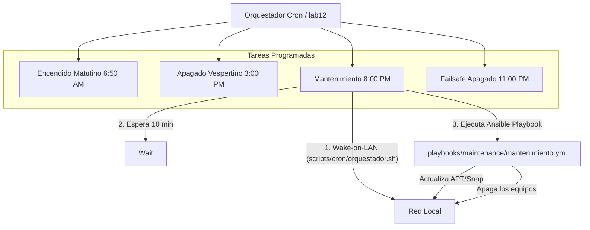

# Automatización y Mantenimiento Nocturno

Para garantizar que el laboratorio esté siempre actualizado y listo para los estudiantes sin intervención humana, el repositorio incluye un sistema de auto-curación orquestado mediante **Cron** y **Wake-on-LAN**.

## Topología del Orquestador

Se designa un equipo en la red local (históricamente `lab12`) para que actúe como "Vigilante" u Orquestador. Este equipo debe permanecer encendido o configurado para encenderse por la BIOS.

## Scripts de Bash Híbridos (WOL + Ansible)

Ubicados en `scripts/cron/`, estos scripts están diseñados para leer dinámicamente el inventario de direcciones MAC (`inventory/mac_addresses.txt`). De esta forma, si se cambia un equipo físico, solo se edita el inventario sin tocar el código fuente bash.

- **`orquestador.sh`**: Dispara un Wake-on-LAN (mediante paquetes Unicast y Broadcast combinados para evadir filtros de ruteadores Mesh/Deco), espera a que los equipos levanten servicios SSH, y luego dispara el playbook de Ansible de mantenimiento para actualizar repositorios, paquetes y apagar de nuevo.
- **`vigilante.sh`**: Diseñado para correr cada X minutos, hace ping a las PCs y si alguna está apagada (por ejemplo, si un estudiante la apagó por error en pleno horario escolar), le envía un paquete mágico para re-encenderla.
- **`solo_encender.sh`**: Dispara Wake-on-LAN de forma veloz a todo el inventario.

## Configuración del Crontab

En el nodo Orquestador, deberás instalar `wakeonlan` (`sudo apt install wakeonlan`) e importar el Crontab. Revisa el archivo `docs/crontab.sample` para copiar las tareas programadas con tus rutas locales ajustadas.
