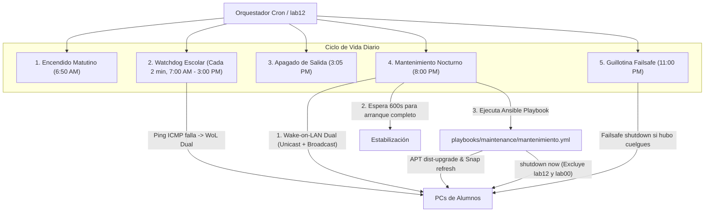

# Automatización, Auto-Curación y Ciclo de Vida Nocturno

Para garantizar que el aula de cómputo permanezca operativa, actualizada y con cero intervención presencial de administradores, la infraestructura cuenta con un **ciclo de vida automatizado en 5 etapas** orquestado por **Cron**, **Ansible** y un protocolo dual de **Wake-on-LAN**.

---

## 1. Topología y Rol del Orquestador (`lab12`)

Debido a la ausencia de un servidor dedicado en rack, el nodo **`lab12`** (Lenovo ThinkCentre M720s) asume el rol de **Servidor Edge y Orquestador**. 

Este equipo opera de forma continua 24/7 y se encuentra protegido por una arquitectura de hardening de 9 capas (BIOS auto-boot, desconexión física de botón, bloqueo por software en `systemd-logind`, restricciones DCONF en GNOME y reglas Polkit). Para una explicación profunda de este blindaje, consulte [Hardening del Orquestador Edge](orquestador_edge_hardening.md).



---

## 2. Las 5 Etapas del Ciclo Diario

| Horario / Frecuencia | Tarea / Script | Propósito y Comportamiento |
| :--- | :--- | :--- |
| **06:50 AM** (Lun-Vie) | `scripts/cron/solo_encender.sh` | **Encendido de Apertura:** Envía paquetes mágicos WoL a toda la flota para que las máquinas estén en la pantalla de bienvenida cuando lleguen los primeros estudiantes. |
| **\*/2 7-14 \* \* 1-5** | `scripts/cron/vigilante.sh` | **Watchdog de Auto-Curación:** Cada 2 minutos realiza un ping veloz (1s timeout) a cada equipo. Si un alumno apagó un equipo por error o se desconectó el cable de red momentáneamente, el script lo re-enciende de inmediato vía WoL. |
| **03:05 PM** (Lun-Vie) | `playbooks/maintenance/solo_apagar.yml` | **Ahorro Energético Escolar:** Apaga las terminales al terminar las clases del turno vespertino. Omite al orquestador (`lab12`) y al equipo maestro (`lab00`). |
| **08:00 PM** (Diario) | `scripts/cron/orquestador.sh` | **Mantenimiento Integral Desatendido:** Enciende las PCs, espera 10 minutos (600s) a que los discos mecánicos/SSDs y servicios SSH estabilicen, actualiza todos los repositorios y paquetes (APT y Snap), y apaga de forma ordenada los clientes. |
| **11:00 PM** (Diario) | `playbooks/maintenance/solo_apagar.yml` | **Guillotina Nocturna (Failsafe):** Barrido de seguridad para forzar el apagado de cualquier nodo que haya quedado encendido si algún proceso de actualización quedó bloqueado. |

---

## 3. Protocolo Dual Wake-on-LAN (Unicast + Broadcast)

Uno de los mayores retos en redes locales con switches administrados o sistemas Mesh (como **TP-Link Deco**) es que las tablas ARP/CAM de los switches expiran rápidamente cuando una máquina lleva horas apagada. En consecuencia, un paquete de difusión estándar (*broadcast* a `255.255.255.255`) suele ser descartado por el router.

Para solucionar esto, los scripts de este repositorio implementan un **enfoque híbrido de doble envío**:

```bash
# 1. Envío Unicast dirigido directamente a la IP del nodo (atraviesa ruteadores)
wakeonlan -i "$IP" "$MAC"

# 2. Envío Broadcast estándar a nivel de enlace local
wakeonlan "$MAC"
```

Los scripts leen el inventario estructurado desde `inventory/mac_addresses.txt`, separando la lógica del código de los datos de hardware.

---

## 4. Evidencia de Telemetría Real en Producción

A continuación se analizan registros verídicos tomados de la ejecución nocturna en el laboratorio:

### Registro de Mantenimiento (`registro_mantenimiento.log`)
```text
[dom 13 sep 2026 20:00:01 CST] Iniciando protocolo Wake-On-LAN dual (Unicast + Broadcast)...
Despertando PC en 192.168.68.113 (MAC: F8:0F:41:64:14:6D)
Despertando PC en 192.168.68.114 (MAC: 6C:4B:90:B5:9A:11)
Despertando PC en 192.168.68.115 (MAC: 00:D8:61:69:E8:C7)
...
[dom 13 sep 2026 20:00:04 CST] ¡Paquetes mágicos enviados! Esperando 10 minutos (600s)...
[dom 13 sep 2026 20:10:04 CST] Iniciando actualizaciones con Ansible...

TASK [1. Actualizar repositorios y todos los paquetes (APT)] ******************
changed: [lab12]
changed: [lab13]
changed: [lab14]
changed: [lab15]

TASK [2. Actualizar paquetes Snap] ********************************************
changed: [lab12]
changed: [lab13]
changed: [lab14]
changed: [lab15]

TASK [3. Apagar los equipos (EXCLUYENDO lab00 y lab12)] ************************
skipping: [lab12]
changed: [lab13]
changed: [lab14]
changed: [lab15]

PLAY RECAP *********************************************************************
lab12 : ok=3 changed=2 unreachable=0 failed=0 skipped=1
lab13 : ok=4 changed=2 unreachable=0 failed=0 skipped=0
lab14 : ok=4 changed=2 unreachable=0 failed=0 skipped=0
lab15 : ok=4 changed=2 unreachable=0 failed=0 skipped=0
```

### Hallazgos de la Telemetría
1. **Inmunidad del Orquestador:** La tarea 3 (`Apagar los equipos`) evalúa la condición `when: inventory_hostname not in ['lab00', 'lab12']`. En `lab12`, el estado es `skipping: [lab12]`, lo que garantiza que el servidor jamás se apague a sí mismo.
2. **Tolerancia a Nodos Desconectados:** Si un equipo está físicamente desconectado o en mantenimiento de hardware, Ansible marca `unreachable=1` sin interrumpir la ejecución en las demás máquinas de la red.
3. **Idempotencia:** Tanto APT como Snap aplican actualizaciones únicamente si existen versiones más recientes disponibles.
