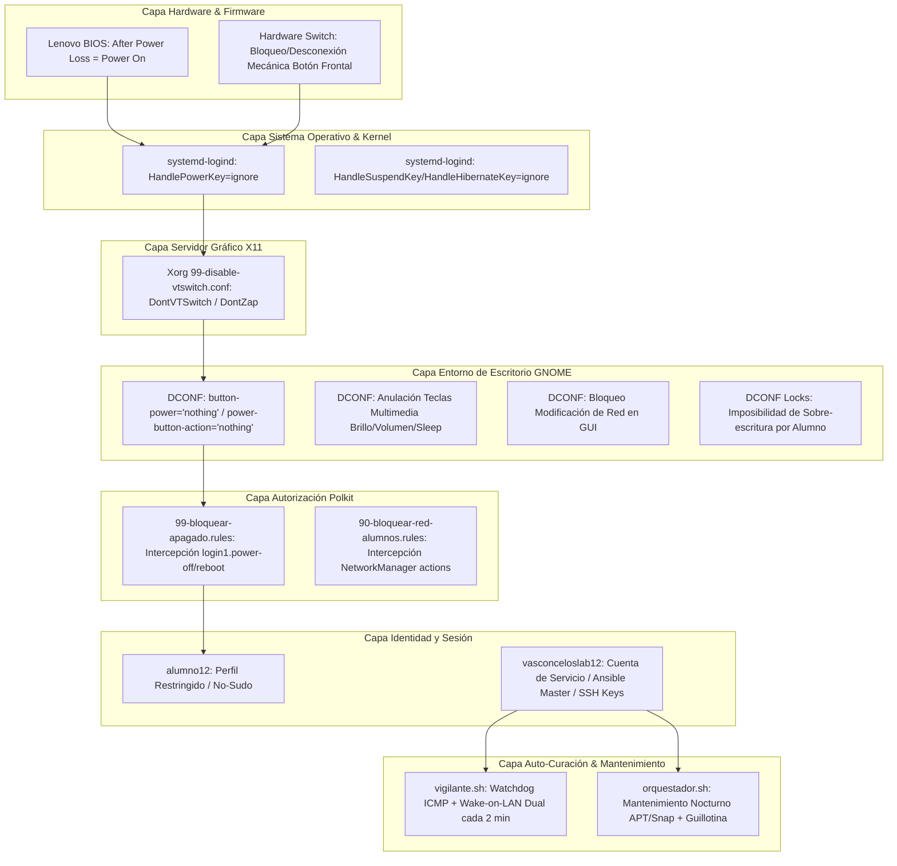

# Hardening y Arquitectura del Orquestador Edge (`lab12`)

> **Caso de Estudio de Infraestructura:** Conversión de una estación de trabajo compartida con alumnos en un nodo de control y orquestación de alta disponibilidad, inmune a manipulaciones físicas, lógicas y cortes de suministro eléctrico.

---

## 1. Contexto Operativo y Desafío de Ingeniería

En entornos educativos o laboratorios públicos de alta densidad, la ausencia de presupuestos para cuartos de servidores dedicados, gabinetes climatizados o hipervisores aislados suele ser la norma. 

En el **Laboratorio de Cómputo Vasconcelos**, la solución arquitectónica consistió en seleccionar estratégicamente un equipo físico del aula (**`lab12` - Lenovo ThinkCentre M720s**) y asignarle un **rol dual simultáneo**:

1. **Estación de Alumno:** Durante el horario lectivo, los estudiantes inician sesión con la cuenta `alumno12` para realizar prácticas escolares habituales.
2. **Plano de Control y Servidor Edge:** En segundo plano y durante las 24 horas, la cuenta administrativa `vasconceloslab12` opera como nodo maestro de Ansible, emisor de paquetes Wake-on-LAN, recolector de auditorías y watchdog de auto-curación de toda la red local.

### El Reto de Seguridad y Disponibilidad
Convertir una máquina accesible al público estudiantil en el servidor maestro introduce vectores de falla críticos:
- **Apagado accidental o intencional:** Estudiantes que presionan el botón físico de encendido/apagado, eligen "Apagar" en el menú de GNOME, o usan combinaciones de teclado.
- **Manipulación de red:** Estudiantes que desactivan la interfaz Ethernet o WiFi mediante el panel de control.
- **Cortes de energía eléctrica:** Si el suministro eléctrico del edificio se interrumpe y la máquina queda apagada, todo el ecosistema de automatización del laboratorio colapsa.
- **Acceso a terminales TTY:** Estudiantes que acceden a consolas virtuales (`Ctrl+Alt+F1...F6`) para intentar eludir el entorno de escritorio.

Para neutralizar estos vectores sin afectar la experiencia de aprendizaje, se implementó una **estrategia de defensa en profundidad en 9 capas**.

---

## 2. Matriz de Defensa en Profundidad (9 Capas)



---

## 3. Implementación Detallada de Capas

### Capa 1: Firmware BIOS y Modificación Mecánica
- **Auto-Encendido por Recuperación de CA (AC Power Loss State):**  
  En el BIOS del Lenovo ThinkCentre M720s, la directiva `State After G3` / `After Power Loss` está configurada como **`Power On`**. Cuando ocurre una caída del suministro eléctrico general y la energía se restablece, el equipo arranca de forma autónoma sin intervención humana.
- **Inhabilitación Física del Pulsador de Chasis:**  
  El interruptor físico del panel frontal del gabinete fue desconectado internamente o protegido mecánicamente. Cualquier intento físico de pulsar el botón no genera contacto en los pines de la placa base.

### Capa 2: Kernel y `systemd-logind`
Para mitigar cualquier señal ACPI que pudiera filtrarse desde el hardware, el daemon de gestión de sesiones de systemd fue configurado mediante `playbooks/maintenance/bloquear_apagado_orquestador.yml` en `/etc/systemd/logind.conf.d/99-ignorar-botones.conf`:

```ini
[Login]
HandlePowerKey=ignore
HandleSuspendKey=ignore
HandleHibernateKey=ignore
HandleLidSwitch=ignore
```
Incluso si el kernel recibe una interrupción de botón de encendido o suspensión, `systemd-logind` la descarta de manera silenciosa.

### Capa 3: Servidor Gráfico X11 (Bloqueo de TTYs)
Para evitar que alumnos salgan del entorno gráfico o fuercen caídas del servidor X, se despliega en `/usr/share/X11/xorg.conf.d/99-disable-vtswitch.conf`:

```text
Section "ServerFlags"
    Option "DontVTSwitch" "true"
    Option "DontZap" "true"
EndSection
```
- `DontVTSwitch`: Desactiva el cambio a consolas de terminal virtuales (`Ctrl+Alt+F1` a `F12`).
- `DontZap`: Desactiva la combinación histórica `Ctrl+Alt+Backspace` que reinicia el servidor gráfico.

### Capa 4: Entorno de Escritorio y Bloqueo DCONF (GNOME)
Edubuntu utiliza GNOME Shell. Se configuró un perfil global de DCONF (`/etc/dconf/profile/user` apuntando a `system-db:local`) con directivas estrictas en `/etc/dconf/db/local.d/`:

1. **Desactivación de Botón de Apagado de GNOME:**
   ```ini
   [org/gnome/settings-daemon/plugins/power]
   button-power='nothing'
   button-sleep='nothing'
   button-suspend='nothing'
   button-hibernate='nothing'
   power-button-action='nothing'
   ```
2. **Neutralización de Teclas Multimedia y Combinaciones de Suspensión:**
   ```ini
   [org/gnome/settings-daemon/plugins/media-keys]
   suspend=['']
   sleep=['']
   hibernate=['']
   power=['']
   screensaver=['']
   control-center=['']
   ```
3. **Persistencia de Sesión y Bloqueo de Red:**
   ```ini
   [org/gnome/desktop/lockdown]
   disable-lock-screen=true
   disable-network-configuration=true

   [org/gnome/desktop/screensaver]
   lock-enabled=false
   idle-activation-enabled=false

   [org/gnome/desktop/session]
   idle-delay=uint32 0
   ```
4. **Candados Obligatorios (`/etc/dconf/db/local.d/locks/`):**  
   Todas las rutas anteriores están añadidas al directorio de candados (`locks`), impidiendo que el usuario pueda modificarlas mediante `gsettings` o la aplicación de Configuración de GNOME.

### Capa 5: Motor de Autorización PolicyKit (Polkit)
A nivel de llamadas D-Bus del sistema, Polkit intercepta cualquier petición privilegiada ejecutada por el alumno:

- **Bloqueo de Apagado/Reinicio (`/etc/polkit-1/rules.d/99-bloquear-apagado.rules`):**
  ```javascript
  polkit.addRule(function(action, subject) {
      if (action.id.indexOf("org.freedesktop.login1.power-off") === 0 ||
          action.id.indexOf("org.freedesktop.login1.reboot") === 0 ||
          action.id.indexOf("org.freedesktop.login1.halt") === 0 ||
          action.id.indexOf("org.freedesktop.login1.suspend") === 0 ||
          action.id.indexOf("org.freedesktop.login1.hibernate") === 0) {
          
          if (!subject.isInGroup("sudo")) {
              return polkit.Result.AUTH_ADMIN;
          }
      }
  });
  ```
  Si el alumno presiona "Apagar" o ejecuta `poweroff` en consola, el sistema solicita credenciales de administrador o rechaza la acción.

- **Bloqueo de Desconexión de Red (`/etc/polkit-1/rules.d/90-bloquear-red-alumnos.rules`):**
  ```javascript
  polkit.addRule(function(action, subject) {
      if (action.id.indexOf("org.freedesktop.NetworkManager.") === 0) {
          if (action.id.match(/(network-control|enable-disable-network|enable-disable-wifi|settings\.modify)/)) {
              if (subject.isInGroup("sudo")) {
                  return polkit.Result.YES;
              } else {
                  return polkit.Result.NO;
              }
          }
      }
  });
  ```
  Impide que los alumnos apaguen el adaptador Ethernet, desconecten la red o alteren parámetros de red.

---

## 4. Servicios de Vigilancia y Mantenimiento

El orquestador aloja tres mecanismos activos para gobernar el laboratorio:

### 1. El Watchdog de Auto-Curación (`vigilante.sh`)
- **Frecuencia:** Cada 2 minutos de lunes a viernes entre 7:00 AM y 2:59 PM (`*/2 7-14 * * 1-5`).
- **Operación:** Realiza un barrido de pings ICMP con un timeout estricto de 1 segundo (`ping -c 1 -W 1`). Si un equipo no responde (porque un alumno lo apagó accidentalmente o se desconectó temporalmente), envía de inmediato un paquete Wake-on-LAN dual:
  - **Unicast:** Enviado directamente a la IP del host para atravesar switches y enrutadores mesh Deco.
  - **Broadcast:** Enviado a la dirección de difusión del segmento.
- **Resultado:** Los equipos de los alumnos se auto-encienden en cuestión de segundos sin requerir asistencia técnica.

### 2. El Ciclo de Mantenimiento Nocturno (`orquestador.sh`)
- **Frecuencia:** Diario a las 8:00 PM (`0 20 * * *`).
- **Operación:**
  1. Despierta todo el laboratorio vía Wake-on-LAN dual.
  2. Espera 600 segundos (10 minutos) para garantizar que los discos duros y servicios SSH inicialicen completamente.
  3. Ejecuta `ansible-playbook -i hosts.ini mantenimiento.yml`.
  4. Realiza `apt-get dist-upgrade`, `autoremove`, `autoclean` y `snap refresh`.
  5. Ejecuta apagado programado en todos los equipos del aula, **excluyendo explícitamente a `lab12` (el orquestador) y a `lab00` (equipo del profesor)**.

### 3. La Guillotina Nocturna (Failsafe 11:00 PM)
- **Frecuencia:** Diario a las 11:00 PM (`0 23 * * *`).
- **Operación:** Si alguna máquina se quedó congelada durante las actualizaciones o algún proceso impidió su apagado, este comando de Ansible fuerza el apagado preventivo para ahorrar energía y preservar los componentes de hardware.

---

## 5. Telemetría Real y Resultados de Ejecución

A continuación se muestra un extracto verificado del log de mantenimiento nocturno (`registro_mantenimiento.log`) obtenido en producción:

```text
TASK [1. Actualizar repositorios y todos los paquetes (APT)] ******************
changed: [lab12]
changed: [lab13]
changed: [lab14]
changed: [lab15]

TASK [2. Actualizar paquetes Snap] ********************************************
changed: [lab12]
changed: [lab13]
changed: [lab14]
changed: [lab15]

TASK [3. Apagar los equipos (EXCLUYENDO lab00 y lab12)] ************************
skipping: [lab12]
changed: [lab13]
changed: [lab14]
changed: [lab15]

PLAY RECAP *********************************************************************
lab12                      : ok=3    changed=2    unreachable=0    failed=0    skipped=1
lab13                      : ok=4    changed=2    unreachable=0    failed=0    skipped=0
lab14                      : ok=4    changed=2    unreachable=0    failed=0    skipped=0
lab15                      : ok=4    changed=2    unreachable=0    failed=0    skipped=0

[Mantenimiento nocturno finalizado con éxito.]
```

Obsérvese cómo en la tarea 3 (`Apagar los equipos`), `lab12` se marca con `skipping: [lab12]`, garantizando que el nodo orquestador permanezca permanentemente en línea para continuar vigilando la infraestructura.
