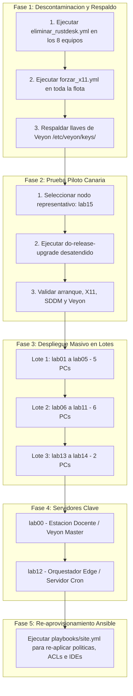

# Plan Maestro de Actualización a Ubuntu 26.04 LTS

> **Estrategia de Migración con Mínima Fricción:** Procedimiento desatendido, por lotes y con verificación canaria para actualizar la flota completa del Laboratorio Vasconcelos de **Ubuntu 24.04.5 LTS** a **Ubuntu 26.04 LTS**, garantizando la compatibilidad absoluta de Veyon (persistencia de X11) y la erradicación limpia de software discontinuado (RustDesk).

---

## 1. Estado y Diagnóstico en Vivo de la Infraestructura

Antes de planificar la migración, se ejecutaron sondeos de telemetría en tiempo real sobre los 16 equipos del laboratorio:

| Parámetro | Estado Detectado | Evaluación para Migración |
| :--- | :--- | :--- |
| **Versión actual de SO** | `Ubuntu 24.04.5 LTS` en el 100% de la flota | Base homogénea lista para salto directo a `26.04.1 LTS`. |
| **Espacio libre en disco (`/`)** | Entre **170 GB y 836 GB libres** por equipo | **Excelente.** No hay riesgo de llenado durante la descarga de paquetes. |
| **Presencia de RustDesk** | Instalado en **8 equipos**: `lab00`, `lab02`, `lab04`, `lab06`, `lab07`, `lab08`, `lab09`, `lab12` | **Punto de fricción crítico.** Debe purgarse antes de actualizar para evitar conflictos con dependencias rotas en `do-release-upgrade`. |
| **Tipo de Sesión Gráfica** | `Type=x11` en el 100% de las sesiones de alumnos | Requiere candados estrictos para impedir que la actualización migre las sesiones a Wayland. |
| **Veyon Actual** | Versión 4.10.1 (compilada para 24.04) | Requiere paquete binario compilado para 26.04 o paquete nativo de repositorios. |

---

## 2. Los Dos Puntos Clave de Compatibilidad

### A. Erradicación Completa de RustDesk
En los 8 equipos donde aún existe `/usr/bin/rustdesk`, el servicio corre en segundo plano y cuenta con archivos de configuración en `/root/.config/rustdesk` y reglas en el cortafuegos UFW. Durante una actualización mayor de distribución, los paquetes instalados manualmente fuera del repositorio oficial que dependen de librerías antiguas pueden bloquear el cálculo de dependencias de APT y abortar el upgrade.
- **Acción:** Ejecución previa de `playbooks/maintenance/eliminar_rustdesk.yml`.

### B. Forzado y Persistencia de X11 para Veyon
El sistema de monitoreo de aula **Veyon** requiere acceso directo al servidor gráfico **X11 / Xorg** para transmitir la pantalla del alumno al docente (`lab00`) y permitir el control remoto sin solicitar permisos interactivos en pantalla. En Wayland, el modelo de seguridad aísla las aplicaciones e impide el monitoreo transparente.
- **En Edubuntu (`lab12` - GNOME / GDM3):** Se fija `WaylandEnable=false` en `/etc/gdm3/custom.conf`.
- **En Lubuntu (`lab00`-`lab11`, `lab13`-`lab15` - LXQt / SDDM):** Se configura `/etc/sddm.conf.d/10-x11-session.conf` con `DisplayServer=x11` y `Session=Lubuntu`.
- **A nivel global:** Variables `QT_QPA_PLATFORM=xcb` y `GDK_BACKEND=x11` en `/etc/environment`.
- **Acción:** Ejecución previa de `playbooks/maintenance/forzar_x11.yml`.

---

## 3. Fases de Ejecución del Plan de Migración



### Fase 1: Descontaminación y Preparación (Inmediata)
1. **Purgar RustDesk:** Ejecutar el playbook `playbooks/maintenance/eliminar_rustdesk.yml` para detener servicios, borrar binarios, eliminar configuraciones y cerrar el puerto `21118` en UFW.
2. **Blindar X11:** Aplicar `playbooks/maintenance/forzar_x11.yml` para asegurar que tras la actualización, tanto SDDM como GDM3 levanten obligatoriamente en modo Xorg.
3. **Respaldo de Secretos:** Confirmar el respaldo de las llaves públicas y privadas de Veyon (`files/veyon_publica_profesor.pem`).

### Fase 2: Prueba Piloto Canaria (Canary Deployment)
Para no arriesgar la disponibilidad del laboratorio, se actualizará un único equipo piloto (**`lab15`**):
1. Lanzar actualización desatendida mediante:
   ```bash
   ansible -i inventory/hosts.ini lab15 -m shell -a "DEBIAN_FRONTEND=noninteractive do-release-upgrade -f DistUpgradeViewNonInteractive" -e @vault.yml --become
   ```
2. Reiniciar el nodo piloto y verificar:
   - Que SDDM inicie sesión automáticamente en `alumno15`.
   - Que `loginctl show-session` confirme `Type=x11`.
   - Que la conectividad SSH hacia `vasconceloslab15` funcione.
   - Que Veyon Service se levante correctamente y sea visible desde `lab00`.

### Fase 3: Despliegue Masivo por Lotes (Batch Upgrade)
Para evitar saturar el ancho de banda del router mesh Deco al descargar varios gigabytes de paquetes simultáneamente, las terminales de alumnos se actualizarán en 3 bloques escalonados:
- **Lote 1 (5 PCs):** `lab01`, `lab02`, `lab03`, `lab04`, `lab05`.
- **Lote 2 (6 PCs):** `lab06`, `lab07`, `lab08`, `lab09`, `lab10`, `lab11`.
- **Lote 3 (2 PCs):** `lab13`, `lab14`.

### Fase 4: Nodos Críticos (`lab00` y `lab12`)
- **`lab00` (Docente):** Se actualiza y se valida el funcionamiento de Veyon Master y la visibilidad de todas las terminales de alumnos.
- **`lab12` (Orquestador Edge):** Se actualiza al final de la ventana de mantenimiento para asegurar que el motor de Wake-on-LAN y el crontab no se interrumpan durante la migración de los clientes.

### Fase 5: Re-aprovisionamiento y Verificación Final
Una vez que toda la flota esté en Ubuntu 26.04:
1. Ejecutar el playbook maestro `playbooks/site.yml` para re-aplicar:
   - Fondos de pantalla institucionales.
   - Políticas de seguridad y ACLs de terminales (`qterminal`, `discover`).
   - Políticas de privacidad de Firefox.
   - Entornos de programación (Code::Blocks, GCC 13/14, GDB, PyCharm, NetBeans).

---

## 4. Requerimientos para Proceder

Para poner en marcha este plan con la menor fricción posible, requerimos definir lo siguiente:

1. **Autorización para ejecutar la Fase 1:** ¿Procedemos a ejecutar `playbooks/maintenance/eliminar_rustdesk.yml` y `playbooks/maintenance/forzar_x11.yml` en los equipos ahora mismo?
2. **Paquete de Veyon para Ubuntu 26.04:**
   - **Opción A (Recomendada):** Descargar el paquete `.deb` oficial de Veyon compilado para Ubuntu 26.04 (o el release oficial más reciente de su repositorio) y colocarlo en el directorio `files/` del repositorio.
   - **Opción B:** Configurar el rol de Ansible para instalar los paquetes `veyon-service` y `veyon-master` directamente desde los repositorios universe de Ubuntu 26.04.
3. **Ventana de Tiempo:** Definir el día y hora para ejecutar la prueba piloto en `lab15` y posteriormente los lotes de la flota de alumnos.
